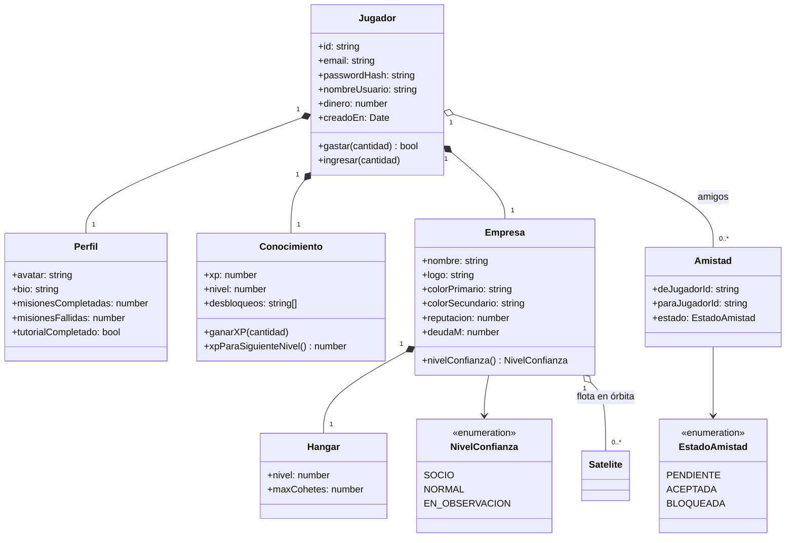
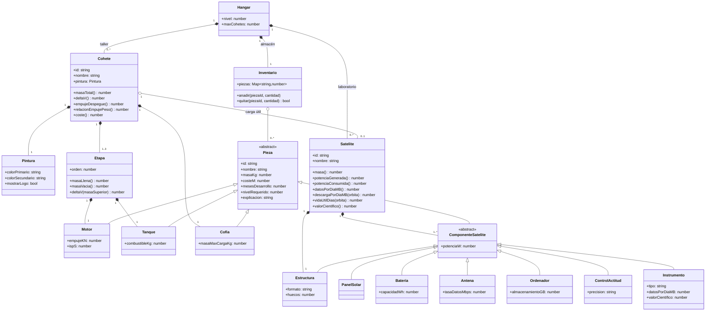
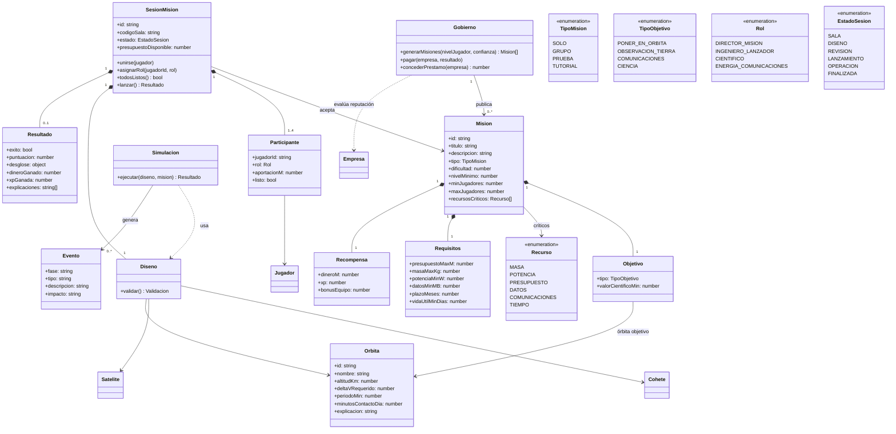
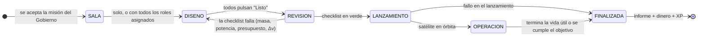
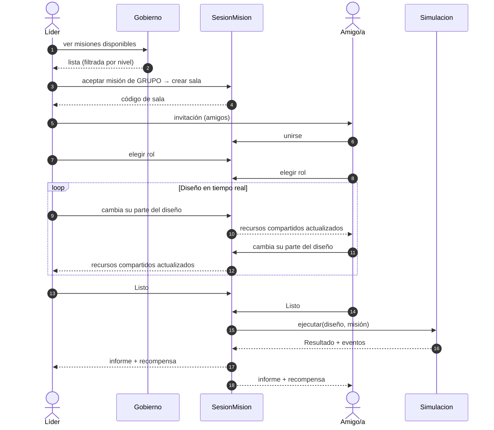

# UML inicial — Space Mission Design Game

> Versión 0.1 · borrador para revisión.
> Los diagramas usan **Mermaid**: GitHub los dibuja solo; en VS Code hace falta la extensión *Markdown Preview Mermaid Support*.

---

## 1. Vista jerárquica (de lo general a lo concreto)

```
Juego
├── Jugador (usuario)
│   ├── Cuenta ............... correo + contraseña (cifrada)
│   ├── Perfil ............... avatar, bio, estadísticas
│   ├── Cartera .............. dinero (M$)
│   ├── Conocimiento ......... XP, nivel, desbloqueos
│   ├── Amistades ............ otros Jugadores
│   └── Empresa .............. nombre, logo, colores (personalizable), reputación, deuda
│       ├── Flota en órbita ... satélites lanzados con éxito
│       └── Hangar
│           ├── Almacén ............... inventario de piezas compradas
│           ├── Laboratorio de satélites → Satélite (carga útil)
│           │     ├── Estructura (CubeSat 1U/3U/6U, bus pequeño)
│           │     ├── Subsistemas: energía, batería, comunicaciones, ordenador, control de actitud
│           │     └── Instrumentos científicos
│           ├── Taller de cohetes (espacio de construcción) → Cohete
│           │     ├── Etapas[] (Motor + Tanque)
│           │     ├── Cofia (protege la carga útil)
│           │     └── Pintura (colores + logo de la empresa)
│           └── Plataforma de lanzamiento .. checklist final y lanzamiento
├── Gobierno (agencia espacial)
│   ├── Confianza en cada empresa (según su reputación) → condiciones de pago
│   ├── Préstamos de rescate
│   └── Misiones / contratos (SOLO | GRUPO | PRUEBA)
│         ├── Objetivo + Órbita objetivo
│         ├── Requisitos (presupuesto, masa, potencia, datos, vida útil)
│         └── Recompensa (dinero + XP)
├── Sesión de misión (una misión en curso)
│   ├── Participantes (1..4) con Rol
│   ├── Diseño (cohete + satélite + órbita)
│   ├── Simulación → Eventos
│   └── Resultado → Informe (por qué salió bien o mal)
└── Catálogo (datos estáticos: piezas, órbitas, misiones, tutorial)
```

---

## 2. Jugador, empresa y progreso



> `passwordHash` guarda la contraseña **cifrada con BCrypt**, nunca en texto plano.

---

## 3. Hangar, cohete y satélite



> `potenciaW` es positiva si el componente **genera** energía (panel solar) y negativa si la **consume** (instrumentos, antena…). Así el balance de potencia es una simple suma.

---

## 4. Gobierno, misiones y modo multijugador



---

## 5. Ciclo de vida de una misión



---

## 6. Propuesta de misión multijugador

**Idea principal (MVP): "Un cohete, varios especialistas".**
El equipo diseña **una sola misión compartida**. Cada rol se encarga de una parte del diseño, pero todos ven en directo los **mismos recursos compartidos**. Así aparece la negociación: si Ciencia añade un instrumento, la barra de potencia de Energía se pone en rojo.

| Rol | Se encarga de | Tensión típica |
|---|---|---|
| Director/a de misión | órbita, presupuesto, aprobar el lanzamiento | "No hay dinero para eso" |
| Ingeniería del lanzador | etapas, motores, cofia (puede partir del cohete de su empresa) | más carga útil = más Δv necesario |
| Ciencia | instrumentos | más ciencia = más masa, potencia y datos |
| Energía y comunicaciones | paneles, baterías, antenas | hay que alimentar y descargar todo |

- Con **2 o 3 jugadores** se juntan roles; **en solitario** se tienen los 4.
- **Costes:** cada jugador paga las piezas de su parte del diseño con el dinero de su empresa (queda registrado en `Participante.aportacionM`).
- **Pago del Gobierno:** se reparte en proporción a lo que aportó cada uno, más un bonus de equipo. La XP es igual para todos, más un bonus por rol.
- **Reputación:** si la misión falla, baja la reputación de **todas** las empresas participantes.
- **Sincronización:** el servidor guarda el diseño compartido y envía cada cambio a los demás por **WebSocket**.
- **Detalle visual:** el cohete lleva los logos de todas las empresas participantes.
- **Variante futura (B): "Constelación".** Cada jugador lanza su propio cohete con un satélite, y la misión se cumple si la constelación entera cubre el objetivo.



---

## 7. Economía

**El jugador paga sus piezas; el Gobierno paga la misión si sale bien. Cuantos más fracasos, menos confía el Gobierno en tu empresa.**

| Concepto | Regla |
|---|---|
| Piezas del cohete y del satélite | Las paga el jugador con el dinero de su empresa **al lanzar**. Se puede diseñar y probar combinaciones gratis; no hay inventario de piezas |
| Cohete al lanzarse | Se consume; el diseño queda guardado como **plantilla** para reconstruirlo |
| Misión cumplida | El Gobierno paga `recompensa × (puntuación / 100)` + XP · **reputación +10** |
| Misión fallida | 0 M$ y el **30 % de la XP** (también se aprende de los fallos) · **reputación −15** |

**Reputación** (0–100, se empieza en 50). Funciona como la confianza del Gobierno en tu empresa:

| Reputación | Nivel de confianza | Qué hace el Gobierno |
|---|---|---|
| 70–100 | **SOCIO** | Adelanta el 50 % del pago al aceptar la misión y ofrece misiones grandes |
| 30–69 | **NORMAL** | Paga al completar la misión |
| 0–29 | **EN_OBSERVACION** | **Deja de pagar.** Solo ofrece **misiones de prueba**: baratas, dan XP y +15 de reputación pero 0 M$. Así recuperas la confianza |

**Préstamo de rescate:** si al lanzar no te llega el dinero, el Gobierno presta la diferencia (`Empresa.deuda`). La deuda se descuenta automáticamente de los siguientes pagos, así nunca te quedas bloqueado. No hay límite de préstamos: con uno solo, la partida se bloqueaba tras una prueba de confianza (que no paga).

---

## 8. Recursos de la misión

Los 6 recursos del reto están **siempre visibles** en un panel del Hangar y del Centro de Control. Cada misión marca cuáles son **críticos** (`Mision.recursosCriticos`): esos aparecen destacados y pesan más en la puntuación.

| Recurso | Cómo se calcula | Qué pasa si no alcanza | Explicación para el jugador |
|---|---|---|---|
| **Masa** | Suma de la masa de todas las piezas | El cohete no llega a órbita (falta Δv) o no despega (empuje/peso < 1,2) | "Cada kilo extra necesita más combustible para subir" |
| **Potencia** | Generación de los paneles − consumo de los componentes | Los instrumentos se apagan por turnos y se pierde ciencia | "El panel es la central eléctrica; si gastas más de lo que genera, algo se apaga" |
| **Presupuesto** | Suma del coste de las piezas frente al dinero de la empresa | No se puede comprar la pieza | "Cada pieza cuesta; el Gobierno solo paga si la misión sale bien" |
| **Datos** | Suma de los datos que generan los instrumentos al día | — (se compara con Comunicaciones) | "Cada foto o medición ocupa espacio, como en tu móvil" |
| **Comunicaciones** | `tasa de la antena × minutos de contacto al día` con las estaciones de tierra (depende de la órbita) | Si los datos superan la capacidad de descarga, el exceso se pierde | "Solo puedes enviar datos cuando el satélite pasa sobre una antena" |
| **Tiempo** | Desarrollo: meses de construcción de las piezas frente a `plazoMeses`. Vida útil: según batería, combustible y órbita frente a `vidaUtilMinDias` | Penalización por retraso, o la misión termina antes de cumplir el objetivo | "Las piezas avanzadas tardan más en construirse; una órbita muy baja frena el satélite y lo hace caer antes" |

Ejemplo de decisiones encadenadas, que es lo que el reto pide mostrar: *añadir una cámara mejor* → más ciencia, pero también **+masa** (hace falta más Δv), **+consumo** (hace falta un panel mayor), **+datos** (hace falta una antena mejor o una órbita con más contacto) y **+coste**.

---

## 9. Valor educativo

1. **Explicar el porqué, no solo acertado o fallado.** `Resultado.explicaciones` cuenta la cadena de causas. Por ejemplo: *"Perdiste el 40 % de los datos: la cámara genera 900 MB/día y tu antena solo descarga 540 MB/día en esta órbita. Prueba una antena en banda S o una órbita con más pasos sobre las estaciones."*
2. **Conceptos en lenguaje sencillo, en el momento en que se usan.** Cada pieza (`Pieza.explicacion`) y cada órbita (`Orbita.explicacion`) tiene una frase corta con una comparación cotidiana. Aparece al pasar el ratón o con un botón ⓘ.
3. **Indicadores visuales antes de lanzar.** Las barras pasan de verde a ámbar y a rojo mientras diseñas. El jugador ve la consecuencia de cada cambio **al instante**, no solo al final.
4. **Academia.** Cada concepto que aparece por primera vez (Δv, órbita, potencia, tasa de datos, ventana de contacto…) se guarda en la Academia para repasarlo, con enlaces opcionales a recursos de la NASA.
5. **Varias soluciones válidas.** Las misiones se pueden resolver de más de una forma (más potencia o menos instrumentos; mejor antena u otra órbita), y el informe compara la solución del jugador con otra alternativa.
