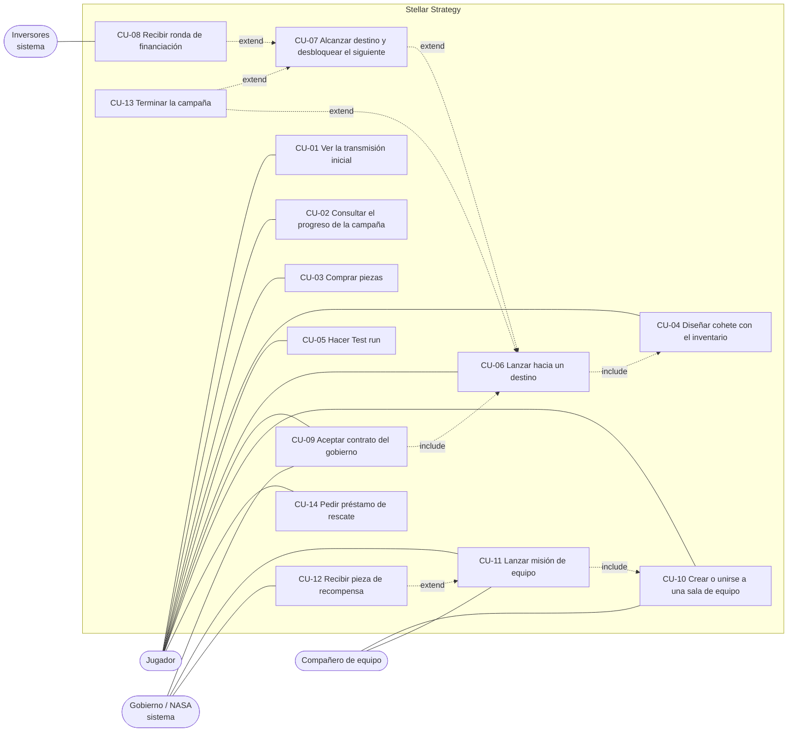
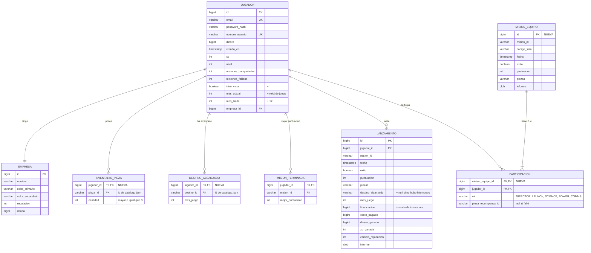
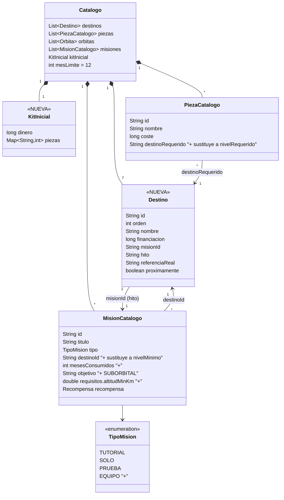
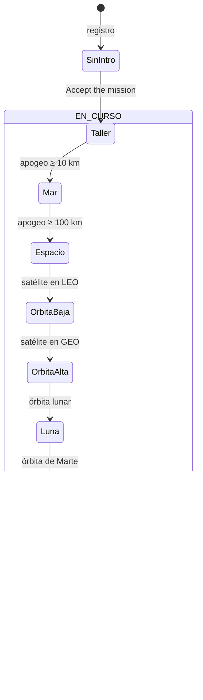
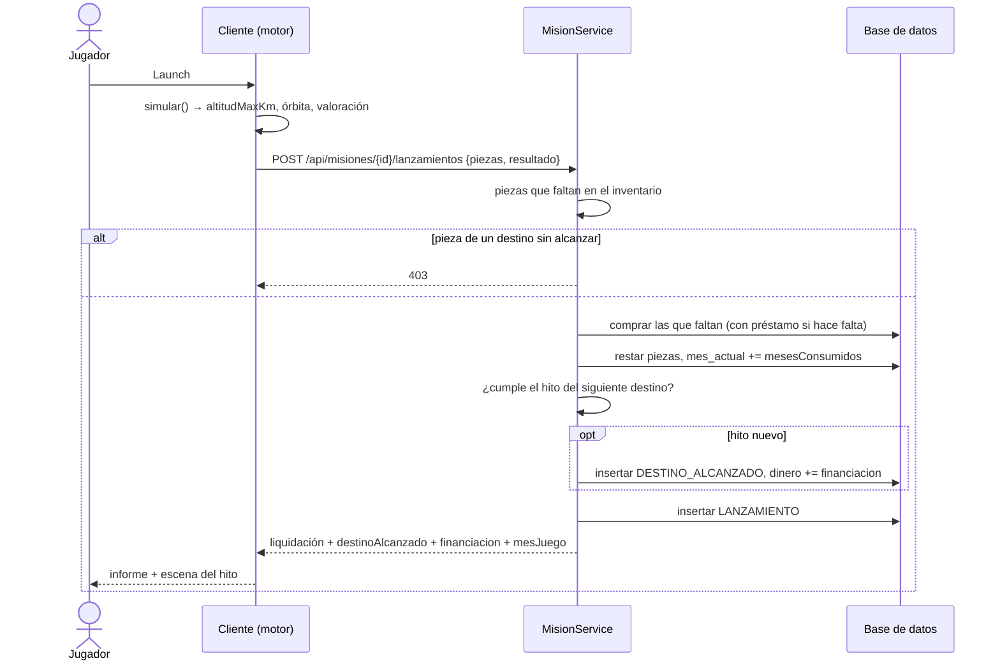
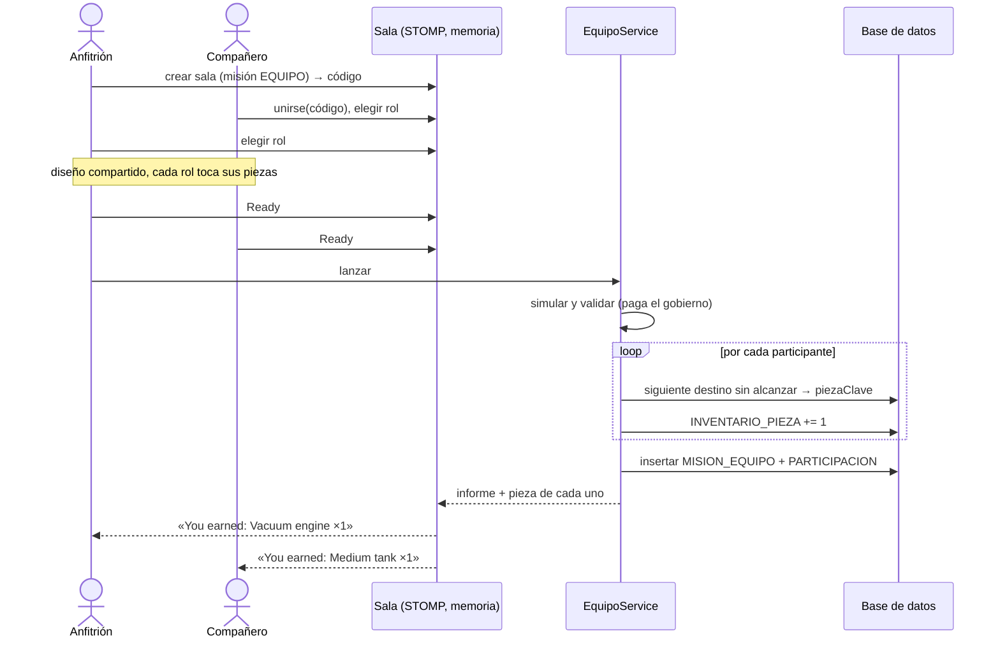

# Campaña «New Home»: casos de uso, historias de usuario y modelo

> Propuesta de diseño (2026-11-14). Cambia la progresión del juego: el jugador empieza sin nada, desbloquea
> destinos cada vez más lejanos y su objetivo final es encontrar un planeta nuevo para la humanidad.
> Los textos visibles para el jugador van en inglés; el resto, en español.
> Las decisiones que faltan por cerrar están en la sección 8.

---

## 1. Resumen del cambio

| Hoy | Con la campaña |
|---|---|
| Empiezas con 10 M$ y lo primero es poner un CubeSat en órbita. | Empiezas con un **kit inicial** que solo da para un cohete sonda que cae al mar. |
| Las piezas se compran del catálogo en cada lanzamiento. | Las piezas forman parte de un **inventario** propio (el Warehouse). Las que faltan se compran al lanzar, y cada lanzamiento gasta las que usa. |
| Las piezas y misiones se desbloquean por **nivel de XP**. | Se desbloquean por **destino alcanzado**: Sea → Space → Orbit → … |
| No hay objetivo final. | Objetivo final: encontrar un planeta habitable antes de que acabe el **reloj de juego** (12 meses de juego, no reales). |
| Solo se juega en solitario. | *(Fase 2)* **Misiones del gobierno en equipo**, en un circuito aparte de la campaña: el gobierno paga el cohete y cada miembro gana **1 pieza relevante** para su propio cohete. |

Se mantienen el motor de simulación, la valoración, la reputación, el préstamo de rescate, el Mission Log y el Test run.

### 1.1 Texto de bienvenida (primer inicio de sesión)

Pantalla completa con ORBI, estilo transmisión entrante:

> **INCOMING TRANSMISSION · NASA**
>
> Planet Earth will not be livable for much longer.
> NASA has chosen your company for the most important mission in history: **find a new home for humanity.**
>
> You have **12 months**. You start with almost nothing: a small workshop, a handful of parts and just enough
> fuel to reach the sea.
>
> Build. Launch. Learn. Every success brings new funding — and takes you one step further from home.
>
> **[ Accept the mission ]**

«12 months» se refiere al reloj de juego: cada lanzamiento consume tiempo de juego, no tiempo real
(sección 3.3).

---

## 2. La escalera de destinos

Cada destino exige un hito, y cumplirlo desbloquea el siguiente destino, sus piezas, sus contratos y una
ronda de financiación. Los hitos siguen la historia real de la exploración espacial, lo que le da al juego
valor educativo.

| # | Destino (`id`) | Hito para alcanzarlo | Referencia real | Desbloquea |
|---|---|---|---|---|
| 1 | Sea (`mar`) | Apogeo ≥ 10 km y caída en el mar | WAC Corporal (1945) | Space · motor-rayo, tanque-mediano |
| 2 | Space (`espacio`) | Apogeo ≥ 100 km, la línea de Kármán | V-2 de White Sands (1946), primeras fotos de la Tierra desde el espacio | Orbit · piezas CubeSat |
| 3 | Low orbit (`orbita-baja`) | Satélite en LEO (hoy es la Misión 0) | Sputnik 1, Explorer 1 | Contratos *Magnetic shield* y *Watching the crops* · GEO |
| 4 | High orbit (`orbita-alta`) | Satélite en GEO | Syncom 3 | *Weather satellite* · Moon |
| 5 | Moon (`luna`) | Sonda en órbita lunar (≈ 3,1 km/s más tras LEO) | Artemis I | Mars |
| 6 | Mars (`marte`) | Sonda en órbita de Marte | Mars Reconnaissance Orbiter | New Home |
| 7 | New Home (`nuevo-hogar`) | Observatorio en L2 que confirma un planeta habitable | JWST, Habitable Worlds Observatory | **Fin de la campaña** |

El destino final es un telescopio y no un viaje al exoplaneta porque ningún cohete puede llegar a otra
estrella. Lo que hace la NASA hoy es buscar el planeta con telescopios, y el juego lo explica así.

**Alcance de la demo** (la versión que se enseña al jurado de la hackathon): destinos 1 a 5, de Sea a
Moon. El 3 y el 4 ya existen como misiones. Los destinos 6 y 7 quedan en el catálogo como «Coming soon».
Para la Luna hacen falta un hito nuevo en el motor (Δv de inyección translunar) y, probablemente, piezas de
sonda nuevas en el catálogo.

---

## 3. Reglas nuevas

### 3.1 Inventario y compra de piezas
- **Kit inicial:** un cohete sonda (motor-sonda, tanque-sonda y cofia-cono), sin dinero en caja. Sube a unos
  61 km; el WAC Corporal real llegó a unos 70. Con dos kits apilados se superan los 100 km.
  Las piezas de órbita (motor-chispa, por ejemplo) no sirven para el kit: con ellas un solo cohete ya llegaría
  al espacio, a más de 1.000 km.
- **Compra al lanzar:** no hay una tienda aparte. En el Hangar se puede instalar cualquier pieza desbloqueada;
  al lanzar, el servidor compra las que falten en el inventario. Una pieza está desbloqueada si se alcanzó su
  `destinoRequerido` o si quedan unidades en el inventario.
- **Lanzar consume** las piezas del diseño, porque los cohetes no se recuperan.
- **Test run** sigue siendo gratis y no consume piezas.
- Si te quedas sin piezas ni dinero, el préstamo de rescate evita que la partida se bloquee.

### 3.2 Financiación
- **Gobierno o NASA:** paga los contratos de misión, igual que ahora (recompensa × puntuación / 100).
- **Inversores:** al alcanzar un destino nuevo por primera vez, entra una **ronda de financiación** fija definida
  en el catálogo (por ejemplo, Sea 3 M$, Space 8 M$, Orbit 20 M$). Se muestra como evento:
  «Investors are impressed — $8M funding round closed».

### 3.3 Reloj de juego
- La campaña empieza en el mes 0 y tiene un límite de **12 meses**.
- Cada lanzamiento real avanza el reloj según la misión: `mesesConsumidos` en el catálogo, 1 por defecto y
  2 para la Luna. Fallar también consume tiempo. El Test run no lo avanza.
- El camino mínimo hasta New Home son 7 lanzamientos, unos 8 meses. Quedan unos 4 meses de margen para
  fallos y contratos del gobierno, y esa presión es la que obliga a usar el Test run con cabeza.
- Si se agota el tiempo, la campaña termina con un final parcial: se muestra hasta dónde llegaste y se
  ofrece seguir en modo libre.

### 3.4 Misiones del gobierno en equipo (fase 2, después de la demo)
- Son un **circuito aparte** de la campaña en solitario, con su propia lista de misiones `EQUIPO`.
  No exigen destinos, no desbloquean destinos y no consumen el reloj de 12 meses. La campaña y el equipo
  solo se tocan en un punto: la pieza de recompensa entra en el inventario.
- Una sala de 2 a 4 jugadores juega una misión de tipo `EQUIPO` (cohete compartido, con los roles de
  [03-PLANIFICACION](03-PLANIFICACION.md)).
- **El gobierno paga el cohete:** nadie gasta piezas ni dinero de su inventario, así que no hace falta
  decidir entre pago por jugador o bote común.
- **Recompensa:** si la misión sale bien, cada miembro recibe **1 pieza relevante**. Es la *pieza clave* del
  siguiente destino que le falta a ese jugador, así que la pieza depende del progreso de cada uno.
- Los hitos de la campaña solo se consiguen con el cohete propio.
- Cualquier jugador puede unirse a cualquier misión de equipo, y por ahora la única recompensa es la pieza.

### 3.5 Finales (implementado el 2026-11-15)

La campaña termina al alcanzar el **último destino jugable** (la Luna en la demo; New Home cuando deje de ser
«Coming soon») o cuando el reloj llega al mes límite sin haberlo alcanzado. El final depende de dos cosas:

| | Con amigos (≥ `misionesConAmigos` victorias de equipo) | Solo |
|---|---|---|
| **A tiempo** (llega en el mes 12 o antes) | `NEW_HOME`: el arca despega con la tripulación completa | `LONE_PIONEER`: llega, pero con 3 asientos vacíos |
| **Fuera de tiempo** | `RELAY`: los amigos terminan la misión | `LAST_SIGNAL`: se pierde la señal |

- Una victoria de equipo cuenta si en la sala había **al menos un amigo** (amistad aceptada) del jugador.
  El umbral está en `catalogo.json` (`misionesConAmigos`, 3 de momento).
- El servidor fija el final una sola vez (`Jugador.finalCampana`), tras un lanzamiento en solitario o tras el
  reparto de una misión de equipo (un fallo puede agotar el reloj). Después se sigue en modo libre.
- El frontend lo enseña al volver del vuelo o de la sala (`zones/Final`), en pixel art como la intro, y
  `POST /api/jugador/final` lo marca como visto. Storyboard: [presentacion/finales-storyboard.html](presentacion/finales-storyboard.html).

---

## 4. Casos de uso

### 4.1 Diagrama

### 4.2 Fichas

**CU-01 Ver la transmisión inicial**
- Actor: Jugador.
- Precondición: cuenta recién creada y `introVista = false`.
- Flujo: 1) Inicia sesión. 2) El sistema muestra la transmisión de la NASA con ORBI. 3) Pulsa «Accept the
  mission». 4) El sistema marca `introVista = true`, arranca el reloj y lleva al jugador al tutorial del
  destino Sea.
- Alternativo: si cierra la pestaña antes de aceptar, la transmisión vuelve a aparecer en el siguiente inicio
  de sesión.

**CU-02 Consultar el progreso de la campaña**
- Actor: Jugador.
- Flujo: en HQ ve el mapa de destinos (alcanzados, el actual y los bloqueados con su hito), los meses
  restantes y el dinero.

**CU-03 Comprar piezas** (al lanzar)
- Actor: Jugador.
- Precondición: la pieza pertenece a un destino alcanzado.
- Flujo: al lanzar (CU-06), el sistema calcula las piezas del diseño que no están en el inventario, las cobra y
  las añade antes de consumirlas.
- Excepción: si no hay saldo suficiente, la Plataforma ofrece el préstamo de rescate (CU-14). Una pieza de un
  destino sin alcanzar devuelve 403.

**CU-04 Diseñar cohete con el inventario**
- Actor: Jugador.
- Flujo: en el Hangar solo puede instalar las piezas de las que tiene unidades disponibles. Cada tarjeta
  muestra «Owned ×N», las instaladas restan del contador y las piezas del catálogo que no tiene se ven con
  candado y el botón «Buy».

**CU-05 Hacer Test run**: igual que ahora. No consume piezas, dinero ni tiempo.

**CU-06 Lanzar hacia un destino**
- Actor: Jugador.
- Precondición: diseño válido y todas sus piezas en el inventario.
- Flujo: 1) Pulsa Launch. 2) El cliente simula y obtiene altitud máxima, órbita alcanzada y valoración.
  3) El servidor valida el inventario, descuenta las piezas, avanza el reloj y guarda el Lanzamiento.
  4) Si se cumple el hito del destino → CU-07.
- Las piezas que no están en el inventario se compran en ese momento (CU-03).

**CU-07 Alcanzar destino y desbloquear el siguiente**
- Actor: Sistema.
- Flujo: guarda `DestinoAlcanzado`, desbloquea las piezas y contratos del siguiente destino, muestra la
  escena del hito («You reached space!») y lanza CU-08. Si el destino es `nuevo-hogar` → CU-13.

**CU-08 Recibir ronda de financiación**
- Actor: Inversores (sistema).
- Flujo: solo la primera vez que se alcanza cada destino, suma `financiacion` al dinero y lo anota en el
  Lanzamiento.

**CU-09 Aceptar contrato del gobierno**: misión con requisitos y recompensa en dinero, igual que hoy.
Ahora exige haber alcanzado el destino de la misión, en lugar de un nivel.

**CU-10 Crear o unirse a una sala de equipo**
- Actores: Jugador (anfitrión) y Compañero.
- Flujo: 1) El anfitrión elige una misión `EQUIPO` y obtiene un código de 6 caracteres. 2) Los compañeros
  entran con el código. 3) Cada uno elige un rol libre.
- Reglas: entre 2 y 4 miembros. Cualquier jugador puede unirse: las misiones `EQUIPO` no dependen de los
  destinos de la campaña.

**CU-11 Lanzar misión de equipo**
- Precondición: todos los miembros han pulsado «Ready».
- Flujo: el anfitrión lanza, el servidor simula y valida, y guarda una `MisionEquipo` con una
  `Participacion` por jugador. No consume inventarios ni avanza el reloj de la campaña.

**CU-12 Recibir pieza de recompensa**
- Actor: Gobierno (sistema).
- Flujo: si la misión sale bien, para cada participante calcula la pieza clave de su siguiente destino sin
  alcanzar, le suma 1 unidad al inventario y se la muestra en el informe («You earned: Vacuum engine ×1»).
- Alternativo: si el jugador ya ha alcanzado todos los destinos, recibe dinero equivalente al coste de la
  pieza.

**CU-13 Terminar la campaña**
- Disparadores: alcanzar `nuevo-hogar` (final completo) o llegar a `mesActual ≥ mesLimite` (final parcial).
- Flujo: muestra la pantalla final con resumen (destinos, lanzamientos, meses usados) y la opción
  «Keep exploring», que pasa al modo libre.

**CU-14 Pedir préstamo de rescate**: igual que ahora.

---

## 5. Historias de usuario

Prioridad MoSCoW: **M** = Must (demo), **S** = Should, **C** = Could. **F2** = fase 2 (multijugador, después de la demo).

| ID | Historia | CU | Prio | Criterios de aceptación |
|---|---|---|---|---|
| HU-01 | Como jugador nuevo, quiero ver una transmisión de la NASA al entrar por primera vez para entender por qué juego. | CU-01 | M | Dado un jugador con `introVista=false`, al iniciar sesión ve la transmisión antes de HQ. · Tras «Accept the mission» no vuelve a verla. · Los jugadores con `introVista=true` van directos a HQ. |
| HU-02 | Como jugador nuevo, quiero empezar con piezas para un cohete sencillo para que mi primer objetivo sea alcanzable. | CU-04 | M | El inventario inicial es el kit del catálogo. · Con ese kit y el diseño recomendado, el apogeo supera los 10 km. · No alcanza los 100 km. |
| HU-03 | Como jugador, quiero que mi primera misión sea lanzar un cohete y que caiga al mar para aprender lo básico sin satélite. | CU-06 | M | La misión `primer-vuelo` no exige satélite. · El informe muestra la altitud máxima y el punto de caída. · La valoración explica Δv y empuje/peso. |
| HU-04 | Como jugador, quiero que al cumplir un hito se desbloquee el siguiente destino para sentir que progreso. | CU-07 | M | Con apogeo ≥ 10 km se guarda el destino `mar` y aparece la escena «Splashdown!». · Con apogeo ≥ 100 km se desbloquea `espacio`. · Un hito ya alcanzado no se repite. |
| HU-05 | Como jugador, quiero recibir dinero de inversores al llegar a un destino nuevo para poder mejorar mi cohete. | CU-08 | M | La primera vez que se alcanza un destino se suma su `financiacion`. · La segunda vez no se suma. · El Mission Log lo muestra. |
| HU-06 | Como jugador, quiero que las piezas que me faltan se compren al lanzar para construir cohetes más potentes sin pasos extra. | CU-03 | M | Solo se pueden instalar piezas de destinos alcanzados (o que ya tengo). · La Plataforma muestra cuánto hay que comprar. · Sin saldo, ofrece el préstamo de rescate. |
| HU-07 | Como jugador, quiero ver cuántas unidades tengo de cada pieza en el Hangar para saber qué puedo construir. | CU-04 | M | Cada tarjeta muestra «Owned ×N». · No se puede instalar una pieza que no está disponible. · Las bloqueadas muestran el destino que hace falta. |
| HU-08 | Como jugador, quiero que lanzar gaste las piezas usadas para que cada lanzamiento cuente. | CU-06 | M | Tras lanzar, el inventario baja según el diseño. · Las piezas que faltan se compran antes de lanzar. · El Test run no gasta nada. |
| HU-09 | Como jugador, quiero ver el mapa de destinos y los meses restantes para planificar. | CU-02 | S | HQ muestra los 7 destinos con su estado y el hito de cada uno. · Muestra «Months left: N». |
| HU-10 | Como jugador, quiero que cada lanzamiento consuma tiempo de juego para que haya tensión. | CU-06 | S | Un lanzamiento real, con éxito o sin él, suma los `mesesConsumidos` de la misión. · El Test run no suma nada. · HQ muestra «Months left: N» de 12. |
| HU-11 | Como jugador, quiero un final cuando encuentro el planeta o se acaba el tiempo para cerrar la historia. | CU-13 | S | Al alcanzar `nuevo-hogar`: final completo. · Con `mesActual ≥ 12`: final parcial con resumen. · Ambos ofrecen «Keep exploring». |
| HU-12 | Como jugador, quiero crear una sala y compartir un código para jugar una misión del gobierno con mis amigos. | CU-10 | F2 | Se genera un código único de 6 caracteres. · Hasta 4 miembros. · Cada uno elige un rol libre. |
| HU-13 | Como miembro de un equipo, quiero ganar una pieza útil para MI cohete al completar la misión para que jugar juntos me ayude a avanzar. | CU-12 | F2 | Si la misión sale bien, cada miembro recibe 1 unidad de la pieza clave de su siguiente destino. · Dos jugadores en destinos distintos reciben piezas distintas. · Si falla, nadie recibe pieza. |
| HU-14 | Como miembro de un equipo, quiero que la misión no gaste mis piezas para no perder nada por ayudar. | CU-11 | F2 | Ni el inventario ni el dinero de los miembros cambian al lanzar en equipo. |
| HU-15 | Como jugador, quiero que cada hito explique su equivalente histórico real para aprender. | CU-07 | C | La escena del hito cita la referencia real (WAC Corporal, V-2, Sputnik…) con un enlace a la NASA. |
| HU-16 | Como jugador que ya jugaba, quiero conservar mi progreso tras el cambio. | — | C | Al migrar, quien terminó `tutorial` recibe `mar`, `espacio` y `orbita-baja` como alcanzados. |

---

## 6. Modelo relacional

### 6.1 Diagrama entidad-relación (base de datos)

Leyenda: «NUEVA» y «+» marcan lo que se añade; el resto ya existe.

Notas:
- `coste_pagado` registra lo que se compró al lanzar (las piezas que faltaban en el inventario).
- La altitud alcanzada y el resultado del vuelo van en el informe JSON, como el resto de la simulación.
- El estado de la campaña (en curso o tiempo agotado) se calcula con `mes_actual` y `mes_limite`: no se guarda.
- `perfil.tutorial_completado` desaparece: equivale a tener `orbita-baja` en DESTINO_ALCANZADO.
- MISION_EQUIPO y PARTICIPACION son de la fase 2 (multijugador).
- Las salas activas (miembros conectados, «Ready», diseño compartido con versión) viven **en memoria** en el
  servidor. Solo se guarda el resultado (MISION_EQUIPO + PARTICIPACION).
- No hace falta una tabla de compras: la compra cambia `dinero` e `INVENTARIO_PIEZA`. Si más adelante se
  quiere un historial económico, se añadiría una tabla MOVIMIENTO.

### 6.2 Catálogo (catalogo.json, no es base de datos)

Las tablas guardan los `id` del catálogo como texto, igual que ya hace `mision_id`.

### 6.3 Estados de la campaña

### 6.4 Secuencia: lanzamiento en solitario que alcanza un destino

### 6.5 Secuencia: misión de equipo y recompensa

---

## 7. Impacto en el código

**Backend**
- `Jugador`: `introVista`, `mesActual`, `estadoCampana`, `Map<String,Integer> inventario`
  (`@ElementCollection` → INVENTARIO_PIEZA) y `destinosAlcanzados` (DESTINO_ALCANZADO). El constructor carga
  el kit inicial en lugar de `DINERO_INICIAL`.
- `Perfil`: se elimina `tutorialCompletado`.
- `MisionService`: cambia la validación (nivel → destino, compra → inventario), el reloj y la comprobación
  del hito.
- Nuevos: `TiendaService` / `TiendaController`, `Destino` y `KitInicial` en el catálogo, y el paquete
  `equipo/` (sala STOMP, `MisionEquipo`, `Participacion`).
- Endpoints:
  - `POST /api/campana/intro` → marca la intro como vista.
  - `POST /api/tienda/compras` `{piezaId, cantidad}`.
  - `GET /api/jugador/me` → añade `campana {introVista, mesActual, mesLimite, estado, destinosAlcanzados}` e
    `inventario`.
  - `GET /api/catalogo` → añade `destinos` y `kitInicial`.
  - `/ws` → salas de equipo.
- Migración: `ddl-auto=update` añade las columnas. En Render la base se borra al redesplegar, así que basta
  con HU-16 para las bases locales.

**Motor (frontend/src/engine)**
- `cohete.js`: `altitudMaxima(diseno)`, el apogeo suborbital a partir del Δv con pérdidas por gravedad y
  arrastre.
- `simulacion.js`: el resultado del vuelo (AMERIZAJE / SUBORBITAL / ORBITA) y la posibilidad de no llevar
  satélite.
- `objetivos.js`: los objetivos «Reach 10 km» y «Reach 100 km».

**Interfaz**
- Pantalla de transmisión (CU-01).
- Mapa de destinos y reloj en HQ.
- Store.
- «Owned ×N» y candados en el Hangar.
- Escena de hito.
- Pantalla final.

**Riesgo conocido:** la simulación corre en el cliente, así que un hito se podría falsear. Para la hackathon
es aceptable; más adelante el servidor debería recalcular `altitudMaxima` con el mismo motor.

---

## 8. Decisiones

Tomadas el 2026-11-14:
1. **Reloj:** 12 meses de juego reales, con final parcial y modo libre si se agotan.
2. **Las piezas se consumen** al lanzar.
3. **XP y nivel** se quedan como rango del jugador («Cadet», «Engineer»…) y dejan de bloquear piezas y
   misiones.
4. **Pieza de equipo:** la pieza clave del siguiente destino de cada jugador.
5. **El multijugador va a la fase 2** y es un circuito aparte, que no se mezcla con la campaña en solitario.
6. **La demo** llega hasta la Luna (destinos 1 a 5).

7. **Equipo (fase 2):** cualquier jugador puede unirse a cualquier misión de equipo, y por ahora la única
   recompensa es la pieza. El campo `piezaClave` de cada destino se añadirá al catálogo en esa fase.
8. **Sin tienda aparte:** las piezas que faltan se compran al lanzar (sección 3.1).
